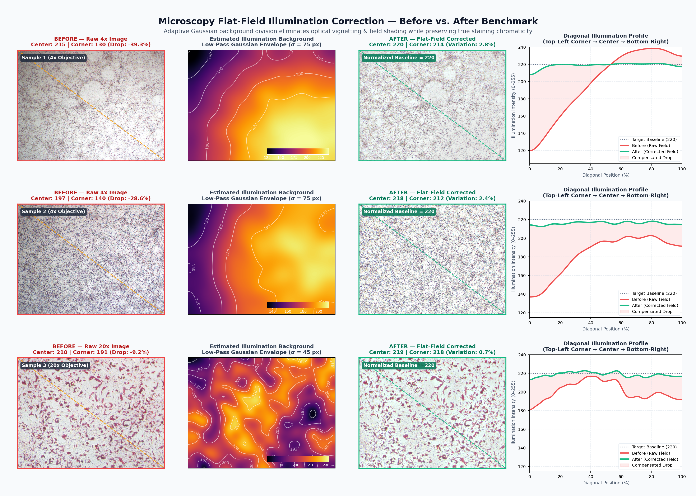
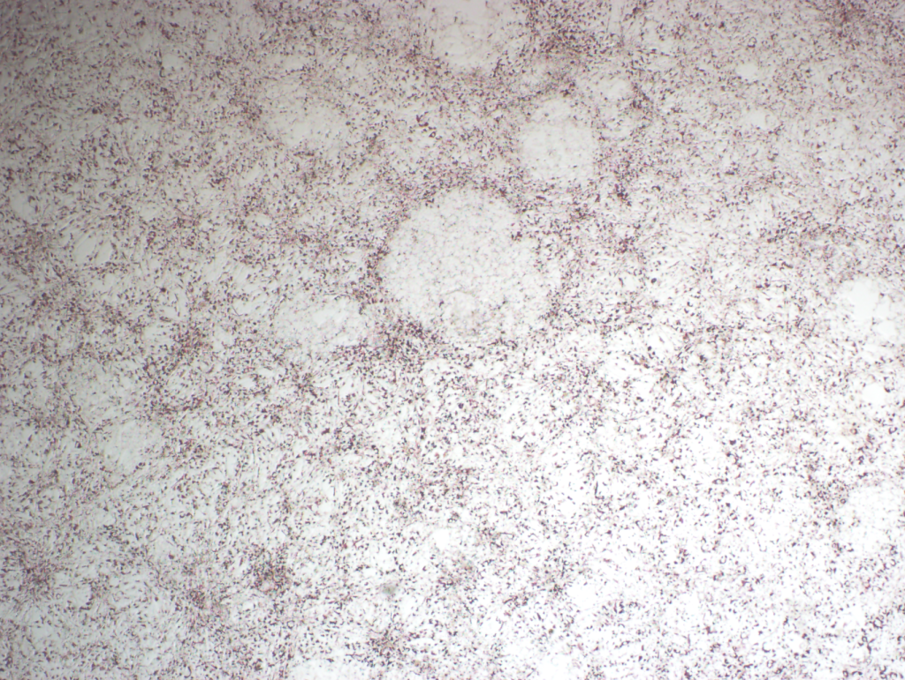
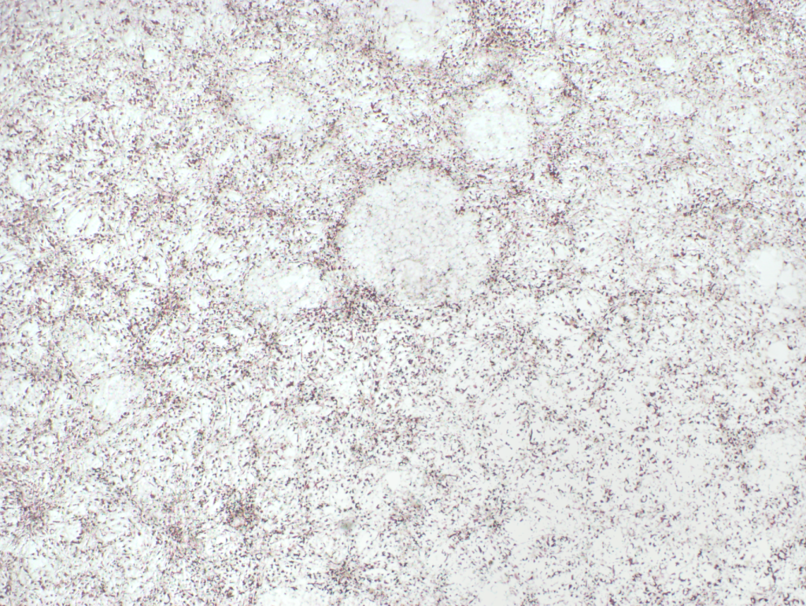
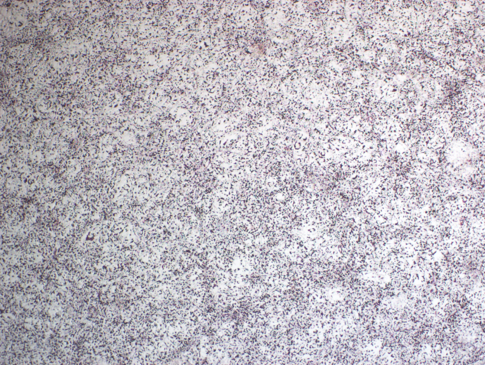
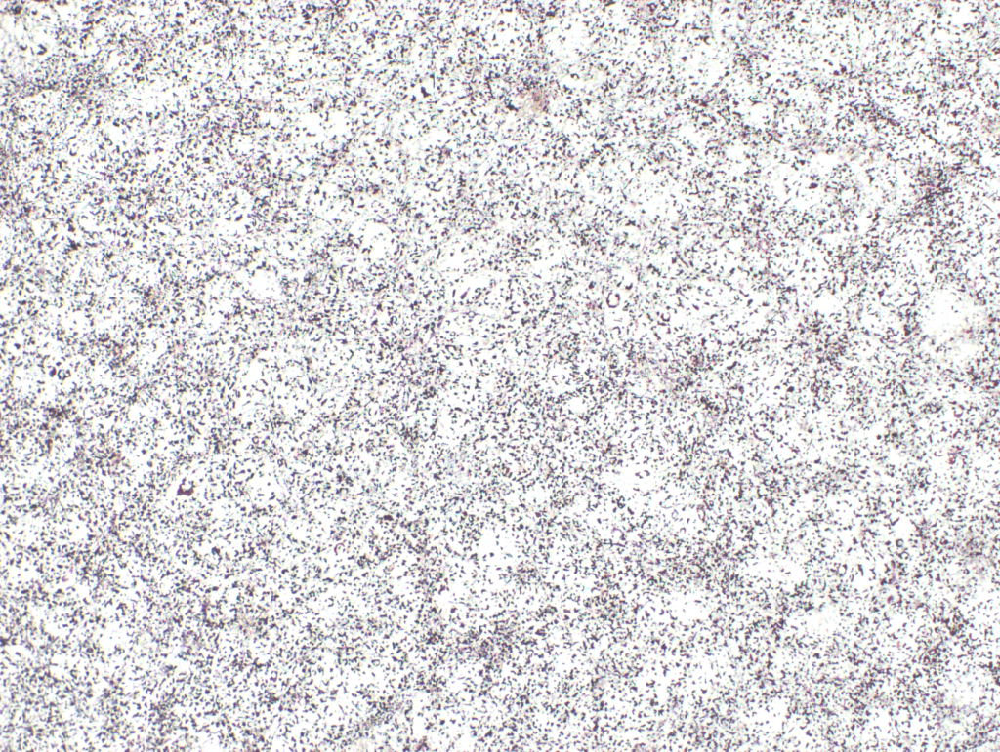
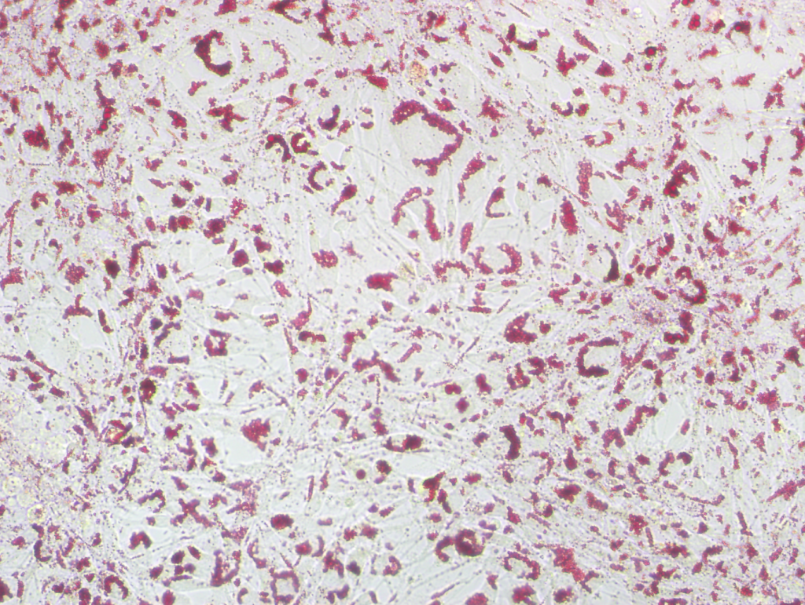
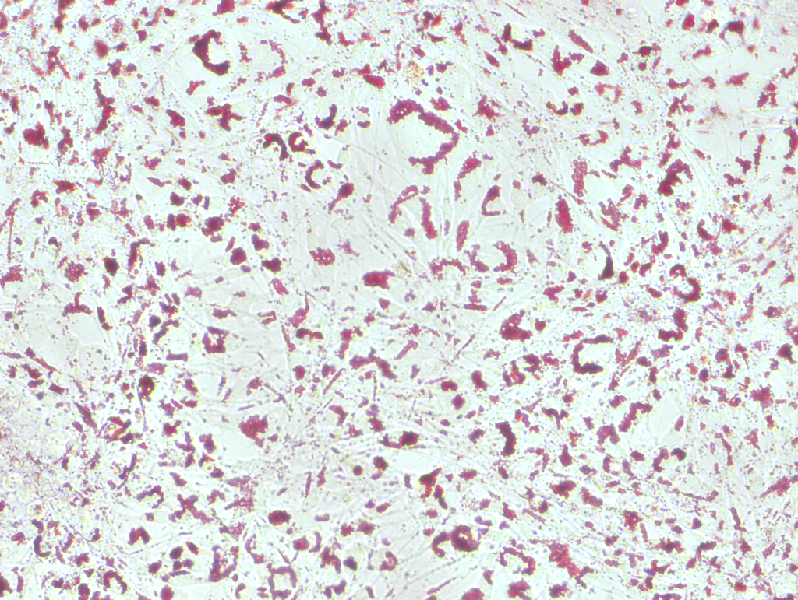

# Microscopy Flat-Field Illumination Correction (`microscopy-flatfield-correction`)

An AI Agent Skill & standalone CLI tool for **adaptive pseudo flat-field illumination correction** in brightfield microscopy images (e.g., Oil Red O staining, H&E histology, immunohistochemistry, and brightfield cell culture).



---

## ✨ Key Features

- **Vignetting & Shading Removal**: Eliminates optical vignetting (dark corners), uneven lamp intensity, and field shading gradients across 4x, 10x, 20x, 40x, and 100x objectives.
- **Background Baseline Normalization**: Standardizes background intensity across different batches or multi-well plates to a clean, uniform white baseline (`target_val = 220.0` by default).
- **Color & Structure Preservation**: Preserves true staining chromaticity, cellular morphology, and lipid droplet boundaries without halo artifacts or resolution loss.
- **Lossless Output & Unicode Path Safe**: Outputs baseline-compliant `.tif`/`.tiff` or `.png` ready for ImageJ/Fiji quantification or publication figures, with built-in memory-buffer I/O supporting non-ASCII (e.g., Chinese) file paths on Windows.

---

## 🔬 Visual Comparison (Before vs. After)

| Sample & Magnification | Before (Raw Microscopy Image) | After (Flat-Field Corrected, Baseline = 220) | Quantitative Improvement |
| :--- | :---: | :---: | :--- |
| **Sample 1 (`4x` Objective)**<br>Wide-field severe corner vignetting |  |  | • **Raw**: Center `215` vs. Corner `130` (**-39.3%** drop)<br>• **Corrected**: Center `220` vs. Corner `214` (**2.8%** variation) |
| **Sample 2 (`4x` Objective)**<br>Symmetric 4-corner vignetting + dense Oil Red O |  |  | • **Raw**: Center `197` vs. Corner `140` (**-28.6%** drop)<br>• **Corrected**: Center `218` vs. Corner `212` (**2.4%** variation) |
| **Sample 3 (`20x` Objective)**<br>Mid-power field shading & off-white tint |  |  | • **Raw**: Center `210` vs. Corner `191` (**-9.2%** drop)<br>• **Corrected**: Center `219` vs. Corner `218` (**0.7%** variation) |

---

## 📐 Mathematical Principle

For each color channel $c \in \{R, G, B\}$, the low-frequency illumination background is estimated via a large-kernel Gaussian filter and normalized to the target baseline intensity:

$$I_{\text{bg}}(x, y) = \text{GaussianBlur}(I(x, y), \sigma)$$

$$I_{\text{corrected}}(x, y) = \text{clip}\left(\frac{I(x, y)}{I_{\text{bg}}(x, y) + 10^{-5}} \times \text{target\_val},\ 0,\ 255\right)$$

### Recommended Sigma by Objective Magnification

| Objective | Magnification Scale | Default $\sigma$ | Typical Artifact Addressed |
| :--- | :---: | :---: | :--- |
| **4x** | Wide-field macro | `75` | Wide-scale optical vignetting across the full field of view |
| **10x** | Low-power | `60` | Moderate corner illumination drop |
| **20x** | Mid-power | `45` | Localized illumination slopes and subtle field gradients |
| **40x / 100x** | High-power | `40` | Subtle center-to-edge lens falloff |

---

## 🚀 Installation

### 1. Install as an Agent Skill

Clone this repository directly into your agent skills directory:

```bash
# For Gemini / Antigravity / Codex skills directory
git clone https://github.com/FrostGUU/microscopy-flatfield-correction.git ~/.gemini/config/skills/microscopy-flatfield-correction
```

### 2. Install Python Dependencies

Requires Python 3.9+:

```bash
pip install -r requirements.txt
```

---

## 💻 CLI Usage

You can run [`scripts/correct_illumination.py`](scripts/correct_illumination.py) directly from the command line.

### Quick Test with Bundled Sample Images

```bash
python scripts/correct_illumination.py single \
  --input-file "assets/examples/sample1_4x_raw.png" \
  --output-file "assets/examples/test_output.png" \
  --mag 4x
```

### Batch Correct a Folder of Images

```bash
python scripts/correct_illumination.py batch \
  --input-dir "path/to/raw_images" \
  --output-dir "path/to/corrected_images" \
  --mag 4x
```

If `--mag` is omitted (default `auto`), the script automatically infers the magnification (`4x`, `10x`, `20x`, `40x`, `100x`) from the input folder name.

### Correct a Single Image

```bash
python scripts/correct_illumination.py single \
  --input-file "path/to/raw.tif" \
  --output-file "path/to/corrected.tif" \
  --mag 20x
```

### Command-Line Options

| Argument | Short | Default | Description |
| :--- | :---: | :---: | :--- |
| `--input-dir` / `--input-file` | `-i` | *(Required)* | Input directory (`batch`) or file path (`single`) |
| `--output-dir` / `--output-file` | `-o` | *(Required)* | Output directory (`batch`) or file path (`single`) |
| `--mag` | | `auto` | Objective magnification (`4x`, `10x`, `20x`, `40x`, `100x`, or `auto`) |
| `--sigma` | | `None` | Explicit Gaussian blur radius override (supersedes `--mag`) |
| `--target-val` | | `220.0` | Target uniform background brightness (`0–255`) |
| `--quality` | | `95` | JPEG quality when saving `.jpg`/`.jpeg` outputs |

---

## 📂 Repository Structure

```text
microscopy-flatfield-correction/
├── SKILL.md                                  # Agent skill definition & instructions
├── README.md                                 # Documentation & visual benchmark
├── requirements.txt                          # Python dependencies
├── .gitignore                                # Git ignore rules
├── assets/
│   ├── flatfield_comparison_overview.png     # 4x & 20x Before/After benchmark figure
│   └── examples/                             # Anonymized raw & corrected sample pairs
│       ├── sample1_4x_raw.png
│       ├── sample1_4x_corrected.png
│       ├── sample2_4x_raw.png
│       ├── sample2_4x_corrected.png
│       ├── sample3_20x_raw.png
│       └── sample3_20x_corrected.png
└── scripts/
    └── correct_illumination.py               # Standalone & agent-callable CLI script
```
